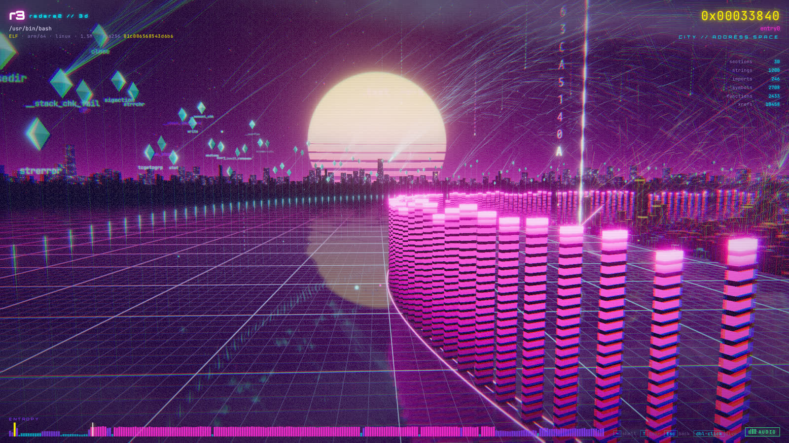
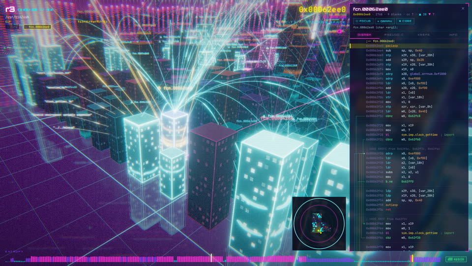
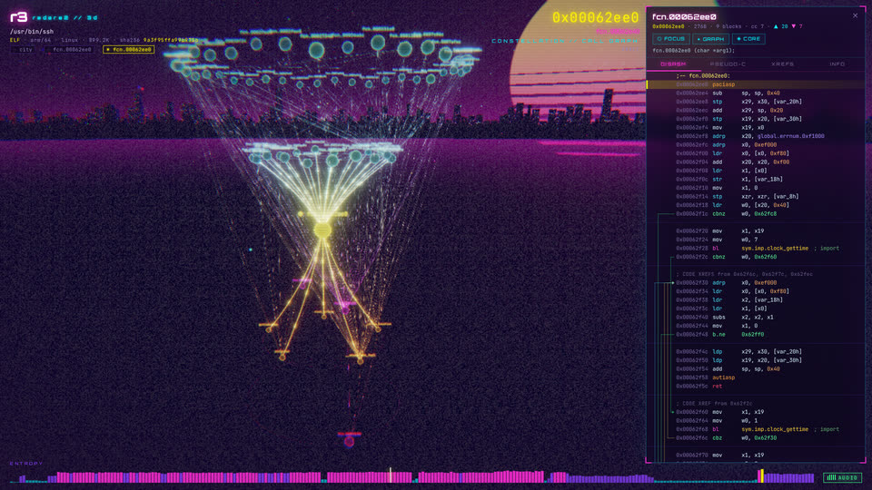
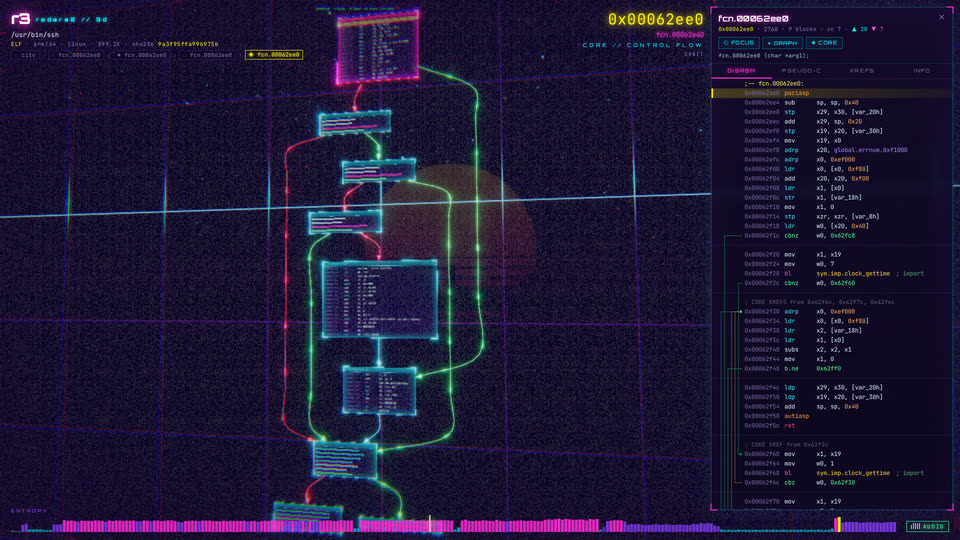
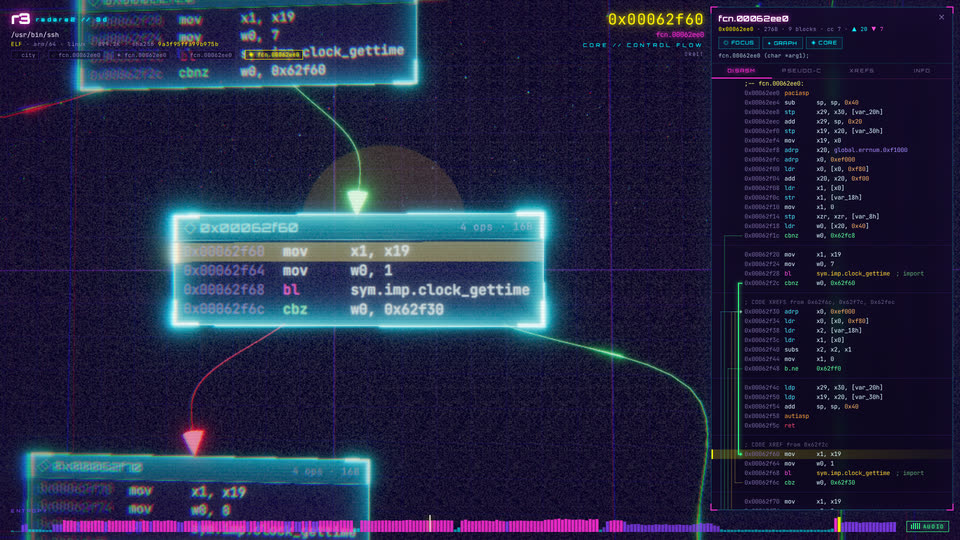
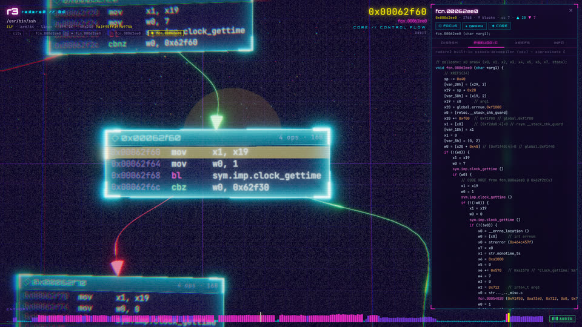
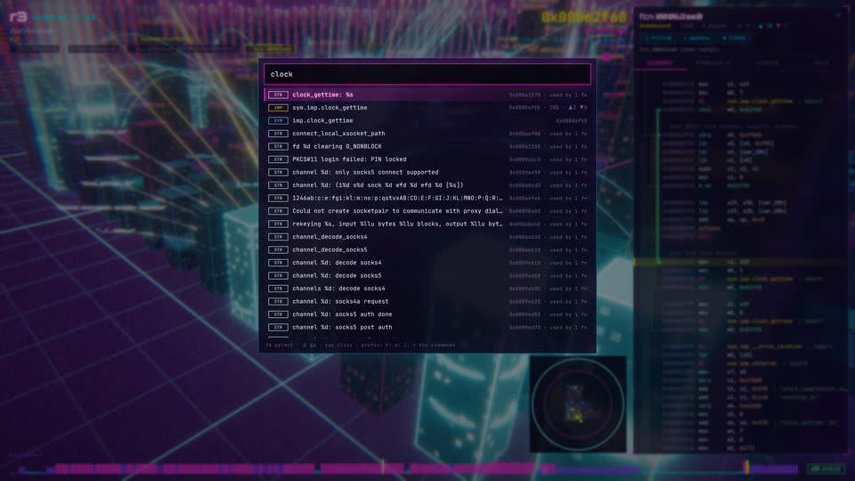
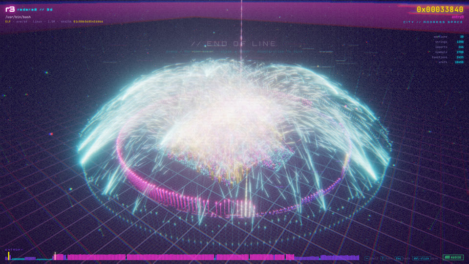
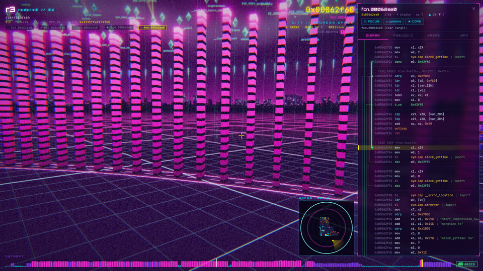

# r3

**radare2, in three dimensions.** Pick a binary that's already on the host, jack in, and fly through it, on the
desktop or in a headset: r3 also has a [VR / MR mode](#headset-webxr) (WebXR, tested on Meta Quest 3).

> r3 is a work in progress, made to have some fun. There are still a few glitches. Contributions are welcome.

r3 is an artistic front end for [radare2](https://github.com/radareorg/radare2): a real r2 session drives a
WebGL world. Functions become a neon city, calls become arcs of light, entropy becomes a ring around the city,
strings drift overhead, and imports orbit as relays. The soundtrack is generated live and seeded by the binary.

Under the art is real analysis. The call graph is exact down to each call instruction. You can orbit the city or fly
it as a drone, focus a function's callers and callees in place, re-centre a call-graph constellation, walk a
function's control flow block by block, and read disassembly, pseudo-C and xrefs in an Inspector that stays in
sync with the 3D view.



| | |
|---|---|
|  |  |
| *Focus: exact call-site arcs, the data column of referenced strings, the synced Inspector* | *Constellation: callers above, callees and imports below; click to re-centre* |
|  |  |
| *Core: the CFG with r2's edge colours (green taken, red fall-through)* | *Flow-walk with the arrow keys; the Inspector follows the seek* |
|  |  |
| *Pseudo-C (`pdc`) next to the graph* | *`Ctrl K`: search functions, imports, strings, sections, addresses* |
|  |  |
| *bash: 19k call sites arcing from caller (cyan) to callee (magenta)* | *Drone mode: fly the streets* |

## Requirements

- radare2 (`r2`) in `PATH`. To build it from source: `git clone https://github.com/radareorg/radare2 && radare2/sys/install.sh`
- Node 22. `install-deps.sh` installs it via nvm if it's missing.

## Install & run

```sh
./install-deps.sh      # checks for r2, installs node (nvm) and npm packages
npm run dev            # server on :3133, vite on :5173 → open http://localhost:5173
```

Production build:

```sh
npm run build
npm start              # serves dist/ + API on http://localhost:3133
```

The server binds to `127.0.0.1`. Set `R3_HOST` / `R3_PORT` to change that. The server browses the host
filesystem, so don't expose it to the internet.

## Native macOS app

```sh
make -C app/mac        # builds app/mac/build/r3.app and app/mac/build/r3.dmg
make distdmg          # builds app/mac/build/r3-release.dmg with notarization
```

The app bundles this WebGL UI and the latest official radare2 WASM command API.
WASM analysis works offline without an installed r2, Node, or a webserver.
The Backend menu also offers an optional local r2pipe process.
Open or drop binaries, choose analysis depth, and keep independent sessions in
native tabs. Cmd+L connects another tab to an existing r2 HTTP server using
`POST /cmd/`. See [app/mac/README.md](app/mac/README.md) for build requirements,
shortcuts, updating WASM, and integration checks.

## The world

| What | r2 source | How it's drawn |
|---|---|---|
| Functions | `aflj` | Holographic towers laid out on a Hilbert curve by address. Height is size, width is basic blocks, colour is cyclomatic complexity. **A tower's vertical axis is its address range: the roof is the entry point, and later code sits further down.** |
| Call graph | `axlj` + `afbj @@F` | Exact call sites, attributed to functions through their real basic blocks (checked against r2's `axtj`/`afxj` by `scripts/graphcheck.ts`). Arcs leave the caller at the floor of the call instruction and land on the callee's roof, pulsing cyan → magenta (amber for imports). |
| Entry point | `iej` | A pillar of light |
| Entropy & sections | `p=ej`, `iSj` | The entropy halo: a ring of bars around the city, coloured by section permissions |
| Strings | `izj` | A drifting text nebula above the skyline |
| Imports | `iij` | An orbital ring of relays, tethered to the ground |
| Function CFG | `agfj` | Glass panels of disassembly, laid out with Sugiyama/dagre in a Web Worker, with routed edges (green taken, red fall-through, cyan unconditional, yellow switch case). Distant panels render as instruction "barcodes"; crisp text is rasterised only for the ~90 panels largest on screen, so 900-block functions stay smooth. |

## Inspecting a binary

**City focus.** Click a tower (or search for it with `Ctrl K`) to select it:

- The city dims, and callers (cyan ▲) and callees (magenta ▼) light up.
- Every call site gets its own arc, starting from a ring on the tower at the exact floor of the `bl`/`call`.
- The strings the function references stand in a column beside it, threaded to the instructions that load them.
- `1` `2` `3` set the focus depth in hops.

**Constellation (`C`).** The call graph re-centred on the selection:

- Callers orbit above, callees below, imports sit on their own amber ring, and second-hop neighbours go further out.
- Click a node to re-centre (nodes that persist glide to their new place).
- Double-click a node to dive into its core.

**Core (`Enter` / double-click).** The function's control-flow graph:

- Flow-walk: `↓` follows the fall-through, `→` the taken branch (repeat to cycle through cases), `↑` goes to a predecessor and `←` steps back.
- `J`/`K` step one instruction at a time.
- Double-click a `call` to follow it into the callee.

**Inspector (`I`).** A docked panel that stays in sync with the 3D view:

- **Disasm:** virtualised, with jump-arrow lanes, xref annotations, string and comment hints, and clickable operands (functions, jump targets, symbols resolved by r2 itself).
- **Pseudo-C:** r2's built-in `pdc`.
- **Xrefs:** callers and callees grouped by function with every call site, plus referenced strings.
- **Info:** the function summary and its variables.

Hovering a line highlights the same instruction in the CFG, or its call arc in the city.

**Getting around:**

- **Palette (`Ctrl K` or `/`):** fuzzy search over functions, imports, strings ("used by N fns"), sections, symbols, `0xaddresses` and commands. Prefixes `f:` `s:` `i:` `>` narrow the search.
- **Drone (`F`):** free flight with `WASD`, `Q`/`E`, `Shift` to boost and the wheel for speed. Look with pointer lock or the right mouse button. You collide with buildings and the ground.
- **Radar:** the minimap shows the city footprint, the focus neighbourhood and your camera cone. Click it to travel.
- **History:** `Alt ←` / `Alt →`, mouse back/forward or `Backspace`, plus a breadcrumb trail.

## Controls

| Input | Action |
|---|---|
| drag / wheel / right-drag | orbit / zoom to cursor / pan |
| click tower · relay | select → focus call graph + Inspector |
| double-click / `Enter` | dive into the control-flow core |
| `C` | call-graph constellation |
| `1` `2` `3` | focus depth |
| `↓ → ↑ ←`, `J` `K` | core: walk the control flow / step instructions |
| `Ctrl K`, `/` | search everything |
| `F` | drone flight |
| `I` | Inspector |
| `~` or `` ` `` | holographic r2 shell |
| `Alt ←` / `Alt →`, `Backspace` | back / forward |
| `T` · `H` · `?` | cinematic tour · overview · help |
| `Esc` | back out (core/constellation → city, clear focus) |

### The shell

Every r2 command runs against the live session, and its output is rendered with r2's colours. Some commands
also move the world:

- `s <addr|flag>` flies there: to the tower floor in the city, or to the block in the core
- `pdf`, `agf`, `VV` dive into the core
- `agc` opens the constellation
- `axt` / `axf` focus the function and open the Inspector's xrefs
- `afl` sends a radar sweep across the city
- `iz` / `ii` / `iS` / `p=e` light up the strings, the import relays and the entropy halo

Meta commands: `:tour`, `:home`, `:drone`, `:open`, `:music on|off|vol N`, `:fx low|med|high|auto`, `:help`.

Once a binary is loaded the session runs with `cfg.sandbox=true`, so shell escapes (`!`) and file access are
blocked. `q` and visual modes are intercepted.

## Headset (WebXR)

r3 runs in a VR headset's browser (built and tested against the Meta Quest 3 browser's WebXR). Two buttons sit above
the radar when the browser supports WebXR:

- **ENTER VR**: you're in the city at life size, at the desktop camera's position.
- **MR**: passthrough. The current view becomes a miniature on a table in your room.

Pick the binary in the 2D page first (JACK IN, then the picker), then enter VR. The Inspector and the shell are
2D only; take the headset view off to use them.

WebXR needs a secure context, so the headset has to open r3 either on `localhost` or over HTTPS:

- **USB (recommended).** Enable developer mode on the headset, plug it in and run `adb reverse tcp:5173 tcp:5173`
  on the machine it's plugged into. Then open `http://localhost:5173` in the headset browser. Nothing is exposed
  to the network.
- **Wi-Fi.** `R3_LAN=1 npm run dev` serves Vite on every interface over HTTPS with a self-signed certificate. Open
  the `Network` URL that Vite prints and accept the certificate warning. **This exposes the API, which browses
  the host filesystem, to everyone on the network.**

| Controller | Action |
|---|---|
| trigger (either hand) | select what the ray points at; press twice quickly to dive into the core / follow a call |
| A · B | dive into the core · back out (like `Enter` · `Esc`) |
| X · Y | call-graph constellation · world scale: life size → giant ×12 → tabletop |
| left stick (+ grip to boost) | fly where you look |
| right stick | snap turn 30° · rise / sink |
| right grip + right-stick flick | core: walk the control flow (↓ fall-through, → taken, ↑ predecessor, ← back) |
| left stick click · right stick click | focus depth 1/2/3 · overview |

A card follows the ray with what it points at. A display above the left controller shows the view, the selection
and these controls. Camera flights move you with them: a short blink re-aims you towards the subject, and a
vignette narrows your peripheral view while you move. In tabletop mode, flights don't move you; the miniature
re-centres when the view changes.

The bloom, CRT pass and ground reflection are desktop-only. They'd cost too much per eye, and the post-processing
chain can't render into the XR framebuffer. Materials apply the same ACES tone mapping instead.

## Audio

Everything is synthesised with Web Audio; there are no samples. The layers are detuned saw pads through a
resonant filter, a sub bass with side-chain pumping, a ping-pong-delayed arpeggiator, soft drums, a rain bed,
FM data chirps and a generated convolution reverb.

The key, mode, progression and tempo are derived from the binary's sha256, so every binary has its own track.
The filter follows the entropy at the current seek, and the function view is darker and more rhythmic.

## Layout

```
install-deps.sh
server/       express + ws; r2pipe over stdio (one r2 per connection), fs browser
src/model.ts  exact call graph / string refs, shared by every view
src/scene/    engine, camera rig (orbit/drone), city, call web, focus layer, constellation,
              CFG core (+ dagre worker), ribbons (screen-space lines), halo, relays, world
src/audio/    procedural score + sfx
src/ui/       boot, picker, HUD, Inspector, palette, minimap, xterm shell
src/xr/       WebXR: headset rig, controllers, comfort, in-headset text cards
scripts/      snap.ts (headless screenshots), wstest.ts (protocol smoke test),
              graphcheck.ts (call graph vs r2 axtj/afxj), navtest.ts (navigation e2e),
              xrtest.ts + xrmock.js (WebXR e2e against a mocked headset)
```

## Dev helpers

```sh
npm run typecheck
npx tsx scripts/wstest.ts /usr/bin/grep              # needs the server running
npx tsx scripts/graphcheck.ts /usr/bin/ssh fcn.00062ee0   # call graph == r2's axtj/afxj
npx tsx scripts/navtest.ts /usr/bin/ssh              # end-to-end navigation test (needs `npm run dev`)
npx tsx scripts/xrtest.ts /usr/bin/ssh shots/xr     # WebXR e2e with a mocked headset; saves stereo frames
npx playwright install chromium                      # once
FN=fcn.00062ee0 npm run snap -- /usr/bin/ssh shots  # needs `npm run dev`; writes shots/*.png
```
