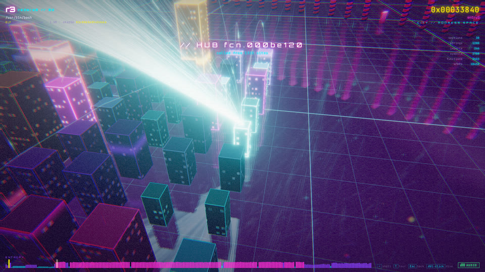
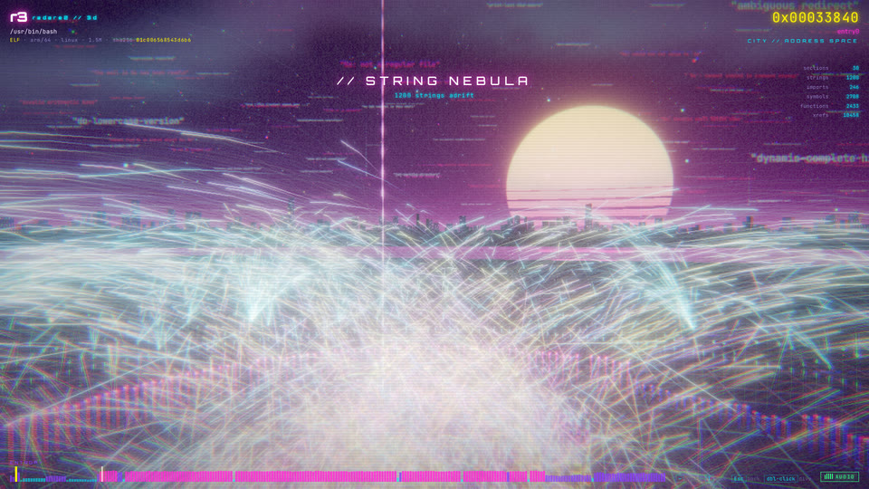
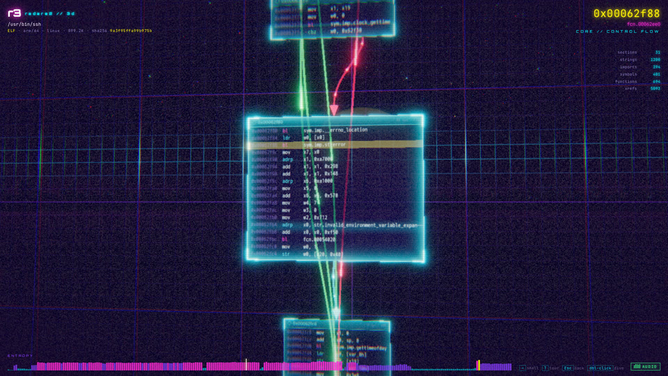

# r3

**radare2, in three dimensions.** Pick a binary that's already on the host, jack in, and fly through it.

r3 is an artistic front end for [radare2](https://github.com/radareorg/radare2): a real r2 session drives a
WebGL world. Functions become a neon city, calls become arcs of light, entropy becomes a ring around the city,
strings drift overhead, and imports orbit as relays. The soundtrack is generated live and seeded by the binary.
It's built to look and feel good rather than to replace r2.


| | |
|---|---|
|  |  |
| *bash's call graph, about 10k arcs over 2,433 function towers* | *Street level: towers sized by function, arcs converging on a hub* |
|  |  |
| *The string nebula* | *Inside a function: the seek highlighted in its basic block* |

## Requirements

- radare2 (`r2`) in `PATH`. To build it from source: `git clone https://github.com/radareorg/radare2 && radare2/sys/install.sh`
- Node 22. `install-deps.sh` installs it via nvm if it's missing.

## Install & run

```sh
./install-deps.sh      # checks for r2, installs node (nvm) and npm packages
npm run dev            # server on :3133, vite on :5173 → open http://localhost:5173
```

Production build:

```sh
npm run build
npm start              # serves dist/ + API on http://localhost:3133
```

The server binds to `127.0.0.1`. Set `R3_HOST` / `R3_PORT` to change that. The server browses the host
filesystem, so don't expose it to the internet.

## The world

| What | r2 source | How it's drawn |
|---|---|---|
| Functions | `aflj` | Holographic towers laid out on a Hilbert curve by address. Height is size, width is basic blocks, colour is cyclomatic complexity (cyan → magenta → yellow). |
| Call graph | `agCj` | Light arcs with pulses running caller → callee |
| Entry point | `iej` | A pillar of light |
| Entropy & sections | `p=ej`, `iSj` | The entropy halo: a ring of bars around the city, coloured by section permissions (r-x magenta, rw- cyan, r-- violet) |
| Strings | `izj` | A drifting text nebula above the skyline |
| Imports | `iij` | An orbital ring of relays, tethered to the ground, with uplink arcs to their callers |
| Function CFG | `agfj` | Glass panels of disassembly connected by beams (green taken, red fall-through, cyan unconditional). Large functions coil into a helix. |

## Controls

| Input | Action |
|---|---|
| drag / wheel | orbit / zoom |
| hover tower | function info |
| click tower | seek there (syncs r2) |
| double-click tower / `Enter` | dive into the function's control flow |
| click an instruction | seek to it |
| `~` or `` ` `` | holographic r2 shell |
| `T` | cinematic tour |
| `H` | overview |
| `Esc` | leave function / deselect / close shell |

### The shell

Every r2 command runs against the live session, and its output is rendered with r2's colours. Some commands
also move the world:

- `s <addr|flag>` flies to that tower, or to that block when you're inside a function
- `pdf`, `agf`, `VV` dive into the function core
- `afl` sends a radar sweep across the city
- `iz` lights up the strings; `ii` lights up the import relays
- `iS`, `p=e` focus the entropy halo

Meta commands: `:tour`, `:home`, `:open`, `:music on|off|vol N`, `:fx low|med|high|auto`, `:help`.

Once a binary is loaded the session runs with `cfg.sandbox=true`, so shell escapes (`!`) and file access are
blocked. `q` and visual modes are intercepted.

## Audio

Everything is synthesised with Web Audio; there are no samples. The layers are detuned saw pads through a
resonant filter, a sub bass with side-chain pumping, a ping-pong-delayed arpeggiator, soft drums, a rain bed,
FM data chirps and a generated convolution reverb.

The key, mode, progression and tempo are derived from the binary's sha256, so every binary has its own track.
The filter follows the entropy at the current seek, and the function view is darker and more rhythmic.

## Layout

```
install-deps.sh
server/       express + ws; r2pipe over stdio (one r2 per connection), fs browser
src/scene/    engine (postprocessing), sky, ground (reflector), city, call arcs,
              entropy halo, imports/strings, function core, particles, world orchestration
src/audio/    procedural score + sfx
src/ui/       boot, picker, HUD, xterm shell
scripts/      snap.ts (headless screenshots), wstest.ts (protocol smoke test)
```

## Dev helpers

```sh
npm run typecheck
npx tsx scripts/wstest.ts /usr/bin/grep              # needs the server running
npx playwright install chromium                      # once
FN=main npm run snap -- /usr/bin/bash shots          # needs `npm run dev`; writes shots/*.png
```
